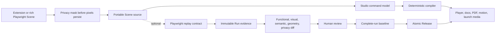

# Architecture

Scenebook is a TypeScript modular monorepo with one portable Scene contract. The creator loop is intentionally independent from Playwright and the cloud; execution and hosted collaboration layer on without changing the authored format.

## Product invariants

- A Scene is one complete outcome. A Step is a meaningful human checkpoint; raw Actions remain debugging evidence.
- Authored source, executable behavior, and captured evidence have separate owners.
- Passwords are never recorded. Sensitive pixels are masked before persistence.
- Evidence and Releases are immutable. Approval promotes a complete successful Run, never a mosaic of unrelated attempts.
- Publishing is atomic and reversible. A Channel points to one complete Release.
- AI can propose a diff. It cannot silently alter narrative, selectors, baselines, Git, or public output.
- Static outputs and the public player have no required cloud dependency.

## Data flow



## Authored Scene directory

```text
invite-member.scene/
  scene.yaml
  narrative.mdx          optional long-form editorial content
  theme.yaml              optional theme override
  locales/
    pt.yaml               optional localized narrative
  assets/
    <sha256>.png          immutable, content-addressed media
  automation/
    replay.ts             optional Playwright contract
```

`scene.yaml` owns presentation and stable bindings. Caption or theme edits can create a new Release without rerunning the browser. Changed actions, targets, or evidence require a new Run and approval.

## Execution and evidence

The Playwright adapter uses public fixture, reporter, `test.step`, attachment, and locator APIs. It captures the pre-State, target semantics and geometry, post-State, checks, source location, masks, and attempt identity. Traces are optional debugging enrichment and never the core serialization contract.

Product Variants and Capture Profiles remain distinct:

- Product Variant: role, plan, locale, theme, feature flags, fixture state
- Capture Profile: browser, viewport, DPR, fonts, OS image, rendering policy
- Run Target: Product Variant × Capture Profile × Environment

Retries and shards retain complete attempt identities so a baseline can only reference one successful Scene attempt.

The reporter bundle is directly ingestible by the control plane:

```text
.scenebook/runs/
  scenes/<scene-id>/<source-revision>.json
  runs/<run-id>.json
  build.json
  assets/<sha256>.<extension>
```

`sourceRevision` is the SHA-256 of the schema-normalized Scene encoded as compact, recursively key-sorted UTF-8 JSON. Run, Build, Baseline, Review, publication candidate, approval attestation, Release, and publication-event hashes use the same canonical JSON contract after schema parsing and defaults. Transport whitespace, including the newline written at the end of JSON files, is never part of the hash. A Build Run reference and an immutable Baseline's `sourceRunRevision` must equal the canonical hash of that exact Run. Passed reporter Runs record Playwright steps and API calls as Actions, assertions as Checks, and project-relative source locations; the server rejects a passed Run with neither Actions nor Checks.

## Storage

Assets are addressed by SHA-256 plus their canonical media identity and are immutable after insertion. The digest identifies bytes; retaining the media type in the key prevents a later declaration of identical bytes from changing how an older Release is read. Deduplication is scoped to a workspace and media type. Scene source is written through same-directory staging plus atomic rename. A Release manifest pins source, narrative, theme, locale, evidence, renderer versions, and output checksums.

The local implementation uses filesystem storage behind the same interfaces expected by S3-compatible object storage. Hosted metadata belongs in PostgreSQL; browser execution stays in customer CI by default.

Studio has two explicit persistence modes. Local mode stores working Scenes, project configuration,
and bounded version history in IndexedDB. Connected mode stores the same compact working-document
layer in PostgreSQL with optimistic revisions and keeps payload bytes in private S3-compatible
object storage. The working-document layer is not canonical Scene evidence: saving a hosted draft
does not create a verified Scene revision, Baseline, approval, or Release.

Before a connected save, the browser moves embedded payloads out of the document, addresses them by
SHA-256 plus media type, and irreversibly flattens authored opaque masks into uploaded screenshots.
The server validates the compact document, streams and verifies each object, and commits the draft
only after every payload is finalized for the same Workspace and Project. Draft revisions keep those
objects protected from retention. Published media is still produced only by the compiler and
promotion pipeline.

PostgreSQL is the hosted default rather than SQLite because collaboration, upload admission,
retention, promotion, and the read-only gateway rely on transactions, advisory locks, concurrent
claiming, row-level compare-and-swap, and database-enforced append-only guards. MinIO is bundled for
an easy local S3 implementation; any compatible service can replace it through the same object-store
configuration.

## Publishing

A Channel is a destination plus policy. A Release is immutable approved content. The CLI resolves Project, Channel, and Collection source into a typed publication plan; the compiler validates that plan against supplied portable Scenes without reading project files. Default plans preserve Collection and entry order and include ungrouped Scenes, while Channel plans filter to ordered `collectionIds`. The resolved selection and policy are recorded in the manifest and per-Scene evidence.

Local Channel builds seal every selected output, deterministic archive, inventory, compiler manifest, and exact evidence copy as one immutable candidate. Promotion validates checksums, privacy, Baselines, separate approvals, localization, and Channel policy without rebuilding, then stages the destination and atomically changes the Channel pointer. Failure restores the prior destination and leaves the previous Release live. Rollback advances the pointer through a new immutable event while reusing the selected Release's verified candidate bytes.

Renderers consume a normalized Scene projection and cannot edit authored source. Motion renderers use the same crop, cursor, timing, caption, and transition model as the interactive preview.

## Extension trust boundary

The extension can use the creator’s active signed-in tab to make a Captured Scene. It excludes typed values from metadata, masks common secret/payment/personal fields and entire embedded-document surfaces before requesting the screenshot, and stores bytes in extension-local IndexedDB until explicit export. This evidence is always labeled unverified.

Verified execution uses controlled Playwright contexts, dedicated fixture accounts, explicit `storageState`, deterministic data, and cleanup. Personal browser state cannot become verified evidence.

## Hosted control plane

Customer CI can explicitly exchange a repository/workflow/ref/commit-bound OIDC assertion for a short-lived token with the sole `artifact:write` permission. It stages a deterministic publication ZIP, its canonical inventory and compiler manifest, evidence objects, and exact request envelopes; after finalization, that token may submit only the matching Scene revisions, Runs, and Build. Baselines, approvals, Releases, and every administrative read remain outside the CI boundary. The self-hosted administrative API binds every evidence reference by ID and canonical hash, then derives Channel readiness server-side. Release approval and promotion independently stream-verify the archive and require the caller's exact Scene set, source revisions, output formats, archive paths/entrypoints, digests, byte lengths, media types, and tree hash to match the typed compiler manifest and inventory. Promotion accepts a baseline-free Release candidate plus evidence IDs; it does not accept caller-authored readiness or approvals. Without explicit upload mode, the GitHub Action remains local-only and requests no OIDC token.

Managed arbitrary-URL execution is out of scope until it has a separate hardened data plane with ephemeral isolation, non-root workers, blocked metadata/control-plane access, restricted egress, run-scoped credentials and storage, and artifact quarantine.
